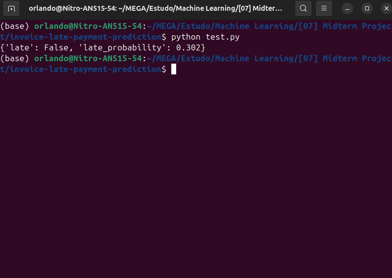
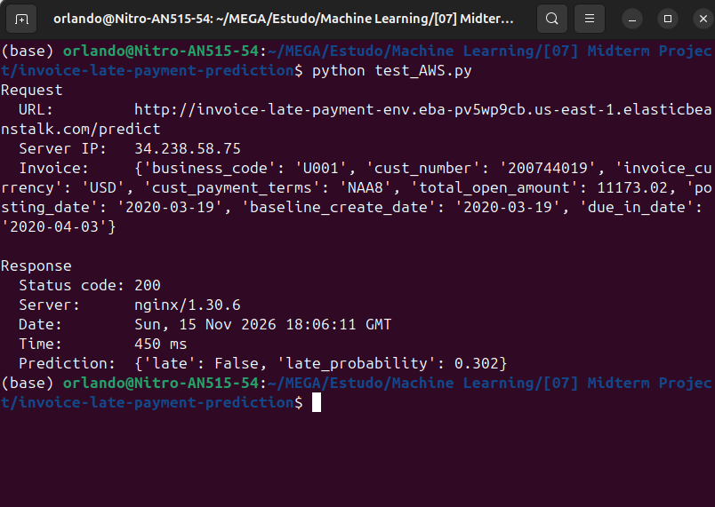

# invoice-late-payment-prediction

Machine Learning Zoomcamp project: predict whether an invoice will be paid after its due date.

> **Status:** complete. Notebook with three models, `train.py`, a Flask web service, Docker and a deployment on AWS Elastic Beanstalk.

## Problem

Late payments hurt cash flow. Given the information available when an invoice is issued (customer, amount, currency, payment terms, dates), the model predicts the probability that the invoice will be paid **after its due date** (`late = 1`). A collections team could use it to prioritize which customers to contact first.

All the analysis is in [`notebook.ipynb`](notebook.ipynb). The sections below follow the notebook's numbering.

## 1. Dataset: download and cleaning

- **1.1 Download.** Kaggle [Payment Date Dataset](https://www.kaggle.com/datasets/rajattomar132/payment-date-dataset) (`rajattomar132/payment-date-dataset`), loaded with `kagglehub`. 50,000 invoices posted between Dec 2018 and May 2020, 19 columns. The dataset has no official data dictionary; column meanings were inferred from their names and values.
- **1.2 Cleaning.**
  - Column names to lowercase; text values to lowercase with `_` instead of spaces.
  - 1,161 duplicated rows (identical in every column) were removed.
  - Useless columns were dropped: `document_create_date.1`, `area_business` (empty), `document_type` (almost constant), `invoice_id` (identifier with nulls), `posting_id` (constant).
- **1.3 Dates.** `yyyymmdd` integers and month/day/year text were converted to `datetime64`.
- **1.4 Target `late`.**
  - Only paid invoices (`isopen == 0`) are used: `late = 1` if `clear_date > due_in_date`, else `0`.
  - The 9,681 open invoices were left out of training. All of them were posted after Feb 27, 2020, and all paid invoices were posted before that date, even though payments are recorded up to May 22, 2020. This is a cut in time (the payment date is not available for the newest invoices), so "open" does not mean "late". They are kept apart as the invoices a deployed model would score.
  - `clear_date` and `isopen` were deleted afterwards to avoid leakage.
  - Result: 39,158 labeled invoices, late rate 0.419.
- **1.5 Features.**
  - Numerical: `days_allowed` (due date minus baseline date), `days_to_due` (due date minus posting date), `due_month`, `due_weekday`, `due_on_weekend`, `log_amount` (`log1p` of the amount; skewness 2.76 before the log, -0.97 after).
  - Categorical: `business_code`, `invoice_currency`, `cust_payment_terms`, `cust_number`.
- **1.6 Split.** Random 60% train / 20% validation / 20% test (`random_state=1`).

## 2. Logistic regression

Numerical features standardized (scaler fitted on the training set only), categorical features one-hot encoded with `DictVectorizer`. Metric: ROC AUC on validation.

| # | Numerical features | AUC, random split | AUC, time split | Notes |
|---|---|---|---|---|
| 2.1 | all 6 (baseline, default settings) | 0.8460 | n/a | `max_iter=100`, convergence warning |
| 2.2 | base: `log_amount`, `days_allowed`, `days_to_due` | 0.8131 | 0.8081 | `liblinear`, `max_iter=1000` from here on |
| 2.2 | base + `due_on_weekend` | 0.8443 | 0.8382 | Biggest gain |
| 2.2 | base + `due_weekday` | 0.8258 | 0.8189 | |
| 2.2 | base + `due_month` | 0.8131 | 0.8079 | No gain |
| 2.2 | base + all calendar features | **0.8463** | 0.8403 | Best logistic regression |

- **2.3 Random vs time-based split.** The time-based split trains on the oldest 60% of invoices (Dec 2018 to Aug 2019), validates on the next 20% and tests on the newest 20% (Nov 2019 to Feb 2020). Its AUC is only about 0.006 lower, and the late rate is stable over time (0.43 / 0.43 / 0.39), so the random split is kept.
- **2.4 Result.** Best feature set: base + all calendar features. A due date on a weekend is the most useful calendar feature (payment tends to slip to Monday). The same features are used for the tree models.

## 3. Random forest

Trees need no scaling, so the unscaled features are used.

| Step | Model | Validation AUC |
|---|---|---|
| 3.2 | Decision tree, default settings | 0.750 |
| 3.3 | Decision tree, `max_depth=25`, `min_samples_leaf=15` | 0.825 |
| 3.4 | Random forest, 10 trees, default settings | 0.842 |
| 3.6 | Random forest, 175 trees, `max_depth=45`, `min_samples_leaf=3` | **0.849** |

## 4. XGBoost

Tuned one parameter at a time: `eta`, then `max_depth`, then `min_child_weight`.

| Step | Model | Validation AUC |
|---|---|---|
| 4.1 | `eta=0.1`, `max_depth=6`, `min_child_weight=1`, 200 rounds | 0.855 |
| 4.3 | `eta=0.5`, `max_depth=7`, `min_child_weight=2`, 200 rounds | **0.870** |

## 5. Final test

The final model is chosen by the validation AUC. The test AUC is shown as a check; it was not used to choose.

| Model (trained on the 60% training set) | Validation AUC | Test AUC |
|---|---|---|
| Logistic regression | 0.8463 | 0.8439 |
| Random forest | 0.8494 | 0.8533 |
| **XGBoost** | **0.8700** | **0.8747** |

**Final model: XGBoost.** Trained again on train + validation (80% of the data), its **test AUC is 0.8840**.

## Files

| File | Purpose |
|---|---|
| `notebook.ipynb` | Data preparation, the three models, tuning and the final test |
| `train.py` | Trains the final XGBoost and saves it with the `DictVectorizer` to `model.bin` |
| `model.bin` | The saved model |
| `predict.py` | Flask web service with one endpoint, `POST /predict` |
| `test.py` | Sends an example invoice to the local service |
| `test_AWS.py` | Sends the same invoice to the service on AWS and prints the details of the communication |
| `Dockerfile`, `requirements.txt` | Container and pinned library versions |

## Library versions

scikit-learn 1.7.2, pandas 2.3.3, numpy 2.3.5, xgboost 3.4.1. (With pandas 3.x the text-cleaning step does not detect the new string dtype, so keep these versions pinned.)

## Limitations

- Training uses only invoices that were already paid. Invoices still open (posted after Feb 27, 2020) have no known outcome.
- The dataset has no official documentation; some column meanings are assumptions.

## How to run

```bash
pip install -r requirements.txt
python train.py                                   # trains and saves model.bin
docker build -t invoice-late-payment .
docker run -it --rm -p 9696:9696 invoice-late-payment
python test.py                                    # in another terminal
```

`train.py` downloads the dataset with `kagglehub`. `model.bin` is already in the repository, so the Docker image can be built without training.

The service receives one invoice as JSON (dates as `YYYY-MM-DD`) and returns the probability of late payment:

```json
{
  "business_code": "U001",
  "cust_number": "200744019",
  "invoice_currency": "USD",
  "cust_payment_terms": "NAA8",
  "total_open_amount": 11173.02,
  "posting_date": "2020-03-19",
  "baseline_create_date": "2020-03-19",
  "due_in_date": "2020-04-03"
}
```

Expected answer: `{'late': False, 'late_probability': 0.302}`



## Cloud deployment on AWS Elastic Beanstalk

The same Docker image was deployed with the Elastic Beanstalk command line tool:

```bash
pip install awsebcli
eb init -p docker -r us-east-1 invoice-late-payment
eb create invoice-late-payment-env --single --instance_type t3.small
python test_AWS.py                                # uses the address printed by eb create
eb terminate invoice-late-payment-env             # when finished
```

`test_AWS.py` prints the address and IP of the server, the status code and the prediction. The answer came from the AWS server (`nginx` proxy, public IP), with the same prediction as the local service:



The environment was terminated after the test to avoid costs, so the address in `test_AWS.py` is no longer online. To repeat the test, run the commands above and put the new address in `test_AWS.py`.
